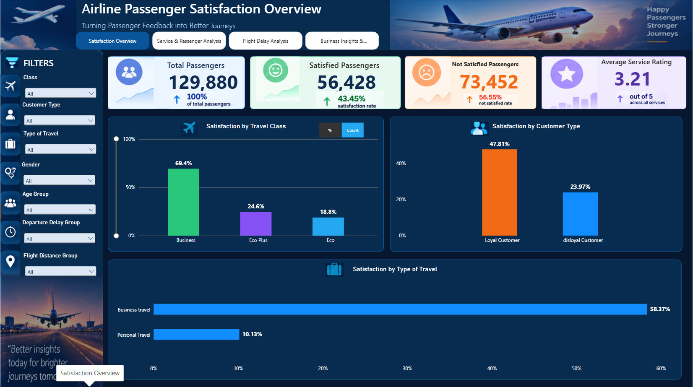
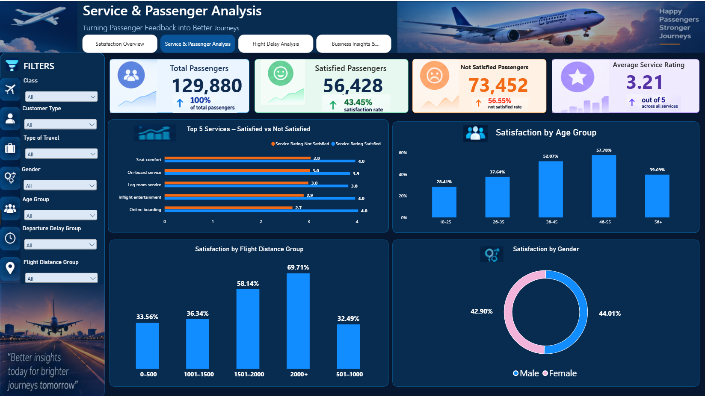
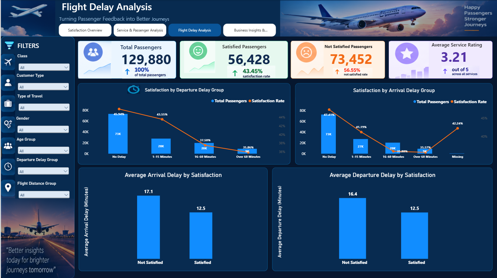
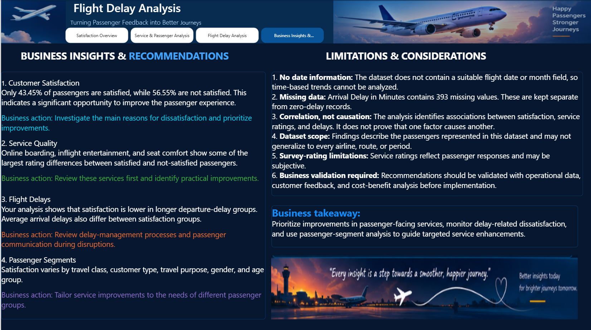

# Airline Passenger Satisfaction Analysis

An interactive Power BI project that analyzes airline passenger satisfaction, service quality, passenger segments, and flight delays using Python and Microsoft Power BI.

## 1. Project Overview

The objective of this project is to understand passenger satisfaction levels and identify the factors associated with passenger dissatisfaction.

The analysis focuses on airline service ratings, passenger characteristics, travel class, type of travel, and flight delays. The findings are presented through a four-page interactive Power BI dashboard.

## 2. Business Problem

Airlines need to understand why passengers are satisfied or dissatisfied with their travel experience.

This project addresses the following questions:

- What percentage of passengers are satisfied?
- Which airline services show the largest rating differences?
- How does satisfaction vary across passenger groups?
- What relationship can be observed between flight delays and passenger satisfaction?

## 3. Dataset Information

- **Dataset:** Airline Passenger Satisfaction
- **Source:** Kaggle
- **Records:** 129,880
- **Original columns:** 22
- **Data type:** Structured passenger survey data

[Download the dataset from Kaggle](https://www.kaggle.com/datasets/arseniyshutko/binary-aviation-satisfaction-129k)

## 4. Tools and Technologies

- **Python:** Data inspection, cleaning, preprocessing, and initial analysis.
- **Microsoft Power BI:** Data visualization, DAX calculations, interactive filters, and dashboard development.

## 5. Data Preparation

The dataset was inspected and prepared using Python in Google Colab.

The main preparation activities included:

- Checking data types and missing values.
- Checking duplicate records.
- Analyzing passenger satisfaction distribution.
- Identifying 393 missing values in Arrival Delay in Minutes.
- Creating Age Group, Flight Distance Group, Departure Delay Group, and Arrival Delay Group categories.

Missing arrival-delay values were retained instead of replacing them with zero, because missing values and zero-minute delays have different meanings.

## 6. Power BI Dashboard

The report contains four interactive pages.

### Page 1 – Satisfaction Overview

Provides an overall view of passenger satisfaction through KPI cards and charts comparing travel class, customer type, and type of travel.

### Page 2 – Service and Passenger Analysis

Compares service ratings between satisfied and not-satisfied passengers and analyzes satisfaction across age groups, flight-distance groups, and gender.

### Page 3 – Flight Delay Analysis

Examines satisfaction across departure and arrival delay groups and compares average flight delays between satisfied and not-satisfied passengers.

### Page 4 – Business Insights and Recommendations

Summarizes the major findings, business recommendations, and limitations of the analysis.

## 7. Key Findings

- Total passengers analyzed: **129,880**.
- Satisfied passengers: **56,428 (43.45%)**.
- Not-satisfied passengers: **73,452 (56.55%)**.
- Average service rating: **3.21 out of 5**.
- Business Class shows the highest satisfaction rate among the travel classes analyzed.
- Online boarding, inflight entertainment, and seat comfort show some of the largest rating differences between satisfied and not-satisfied passengers.
- Satisfaction is lower in the longer departure-delay groups.

## 8. Business Recommendations

- Review online boarding and improve the passenger boarding experience.
- Identify opportunities to improve inflight entertainment and seat comfort.
- Strengthen flight-delay management and passenger communication.
- Use passenger-segment analysis to plan targeted service improvements.

## 9. Project Limitations

- The dataset does not contain a suitable flight date or month field for time-based analysis.
- There are 393 missing values in arrival-delay information.
- The analysis identifies associations, not cause-and-effect relationships.
- Findings are limited to the passengers represented in the dataset.

## 10. Project Files

| File | Description |
|---|---|
| Airline_Passenger_Satisfaction_Analysis.ipynb | Python analysis notebook |
| Final Airline Analysis.pbix | Power BI dashboard |
| CP1_Proposal.pdf | Project proposal |
| Airline_Passenger_Satisfaction_Report_.pdf | Final project report |

## 11. Conclusion

This project demonstrates how passenger data can be transformed into meaningful business insights using Python and Power BI.

The interactive dashboard provides a consolidated view of satisfaction levels, service quality, passenger segments, and flight delays. These findings can help identify areas for further investigation and support better passenger experience decisions.

---

**Project developed by: K. Kishore**
